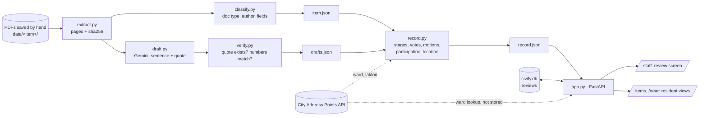
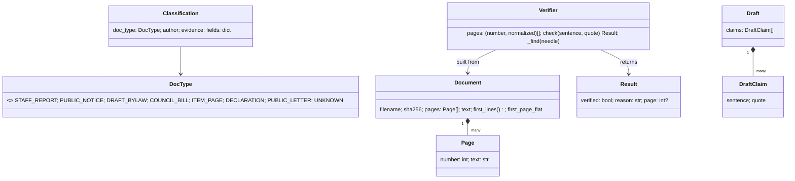
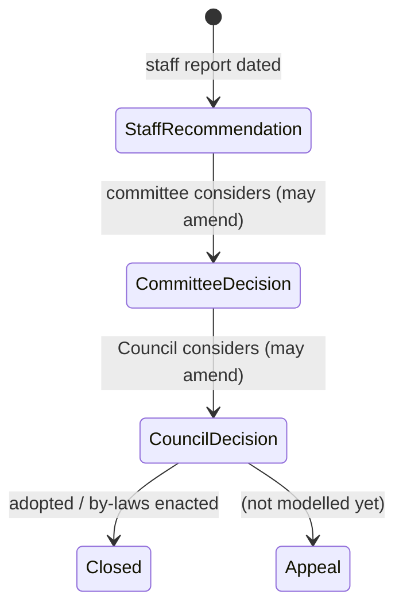
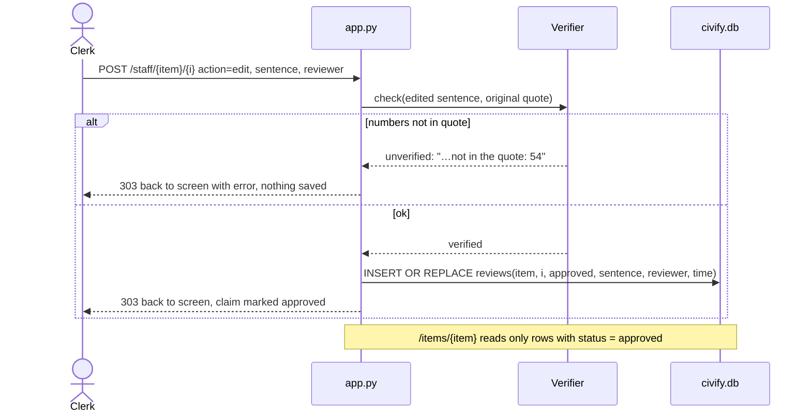

# Architecture

Diagrams are Mermaid (render on GitHub). Each one is drawn from the code as it is, not as planned; if the code changes, change the diagram.

## 1. Pipeline (component view)



## 2. Classes (the data the code passes around)



`record.json` shape (one per item): `item_id, title, ward, location, retrieved, official_url, current_stage, stages[3]{stage, body, date, outcome|status, …, source{file, sha256}}, participation{written_comments_rule, speaker_registration_rule, public_meeting, council_has_decided, basis, source, note}, public_letters, claims[]{sentence, quote, verified, reason, page, source_file, source_sha256}`.

## 3. A claim's life (state)

```mermaid
stateDiagram-v2
  [*] --> Drafted : model proposes sentence + quote
  Drafted --> Verified : quote found, numbers match
  Drafted --> Unverified : not found / number mismatch / too short
  Verified --> Approved : staff approve (or edit; edit re-checked)
  Unverified --> Approved : staff edit so it passes, then approve
  Verified --> Rejected : staff reject
  Unverified --> Rejected
  Approved --> Published : shown on /items
  Rejected --> [*]
```

## 4. An item's stages (state, from the record)



Stages are read from the item page's Tracking Status and section headings; the app never infers one.

## 5. Staff approval (sequence)



## 6. Scalability notes

- **Per item:** extraction ~1 s for 35 pages; one model call (~20 s, ~40k input tokens); verification is milliseconds. A city's weekly agenda (tens of items) is minutes of batch work.
- **Bottlenecks if it grew:** (1) the model call — batchable and cacheable; the report text is the stable prefix. (2) `list_items()` reads every `record.json` per request — fine for hundreds, move to the database for thousands. (3) The live address lookup — ~0.4 s per request against the City API; a pilot would load the Address Points dataset locally.
- **What is Toronto-specific:** `classify.py` rules, `record.py` headings, `geo.py` API. Everything downstream consumes `record.json`, so another municipality supplies those three and keeps the rest.
