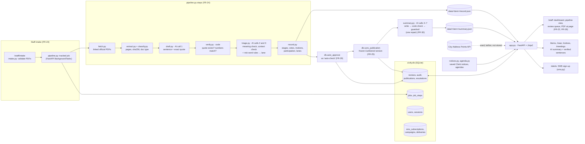
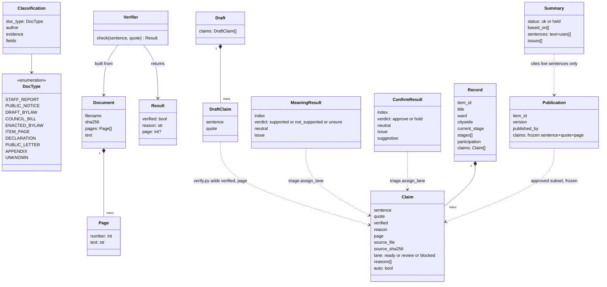
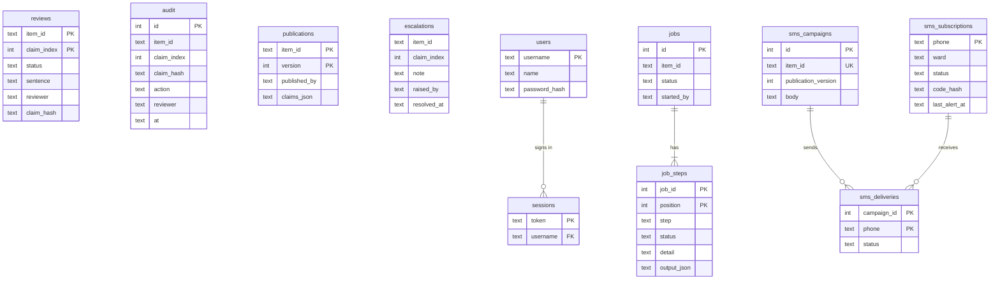
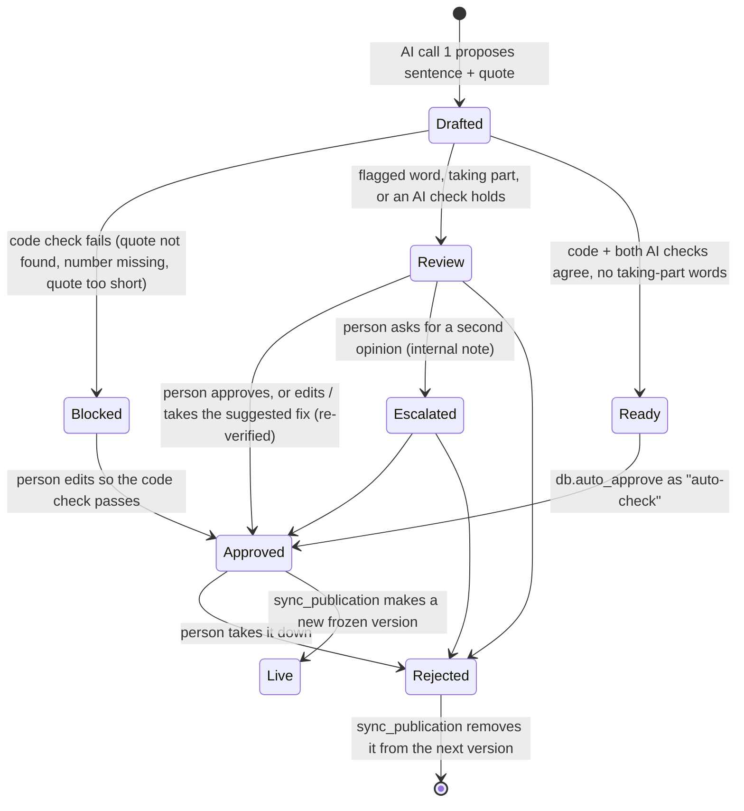
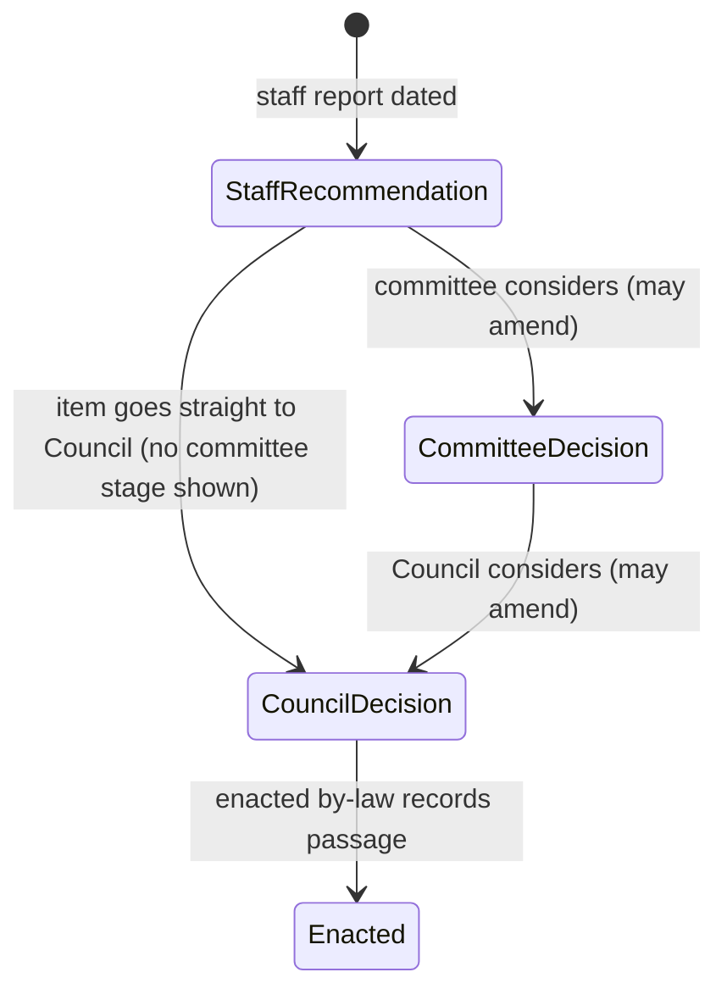
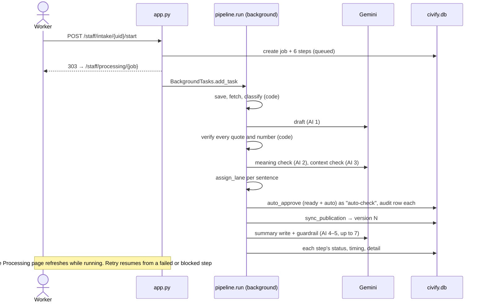
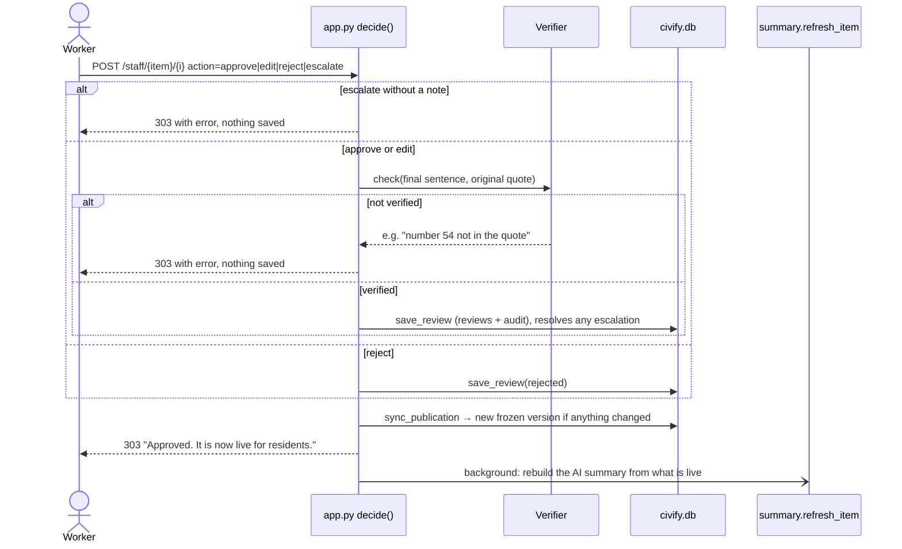

# Architecture

Diagrams are Mermaid (they render on GitHub). Each is drawn from the code as it is on `main`, with the function or table that implements each box. If the code changes, change the diagram. Requirement IDs (FR-xx, NFR-xx) refer to [requirements.md](requirements.md); decision IDs (D-xx) to [decisions.md](decisions.md).

## 1. Components and data flow

AI calls per item: 1 draft, 1 meaning check, 1 context check, then the summary (write + guardrail, plus a second write + guardrail only if the first is held). That is 5 calls normally and 7 at most. Everything between the calls is deterministic code.

## 2. Classes and data shapes

`MeaningResult`, `ConfirmResult` (in `triage.py`) and `Written`/`Checked` (in `summary.py`) are Pydantic models passed to Gemini as the JSON response schema, so a malformed reply fails validation instead of being half-read.

## 3. Database tables (SQLite)

`reviews` holds the current decision per sentence; `audit` is append-only and keeps every decision, including `auto-check` ones. `claim_hash` binds an approval to the exact sentence, quote and source file: if a re-draft changes any of them, the old approval stops counting (`db.current_review`). `publications` is what residents read; it never contains reviewer names, lanes or notes.

## 4. A sentence's life (state)

With `CIVIFY_AUTO_APPROVE=0`, the Ready → Approved transition needs a person (one click for all ready sentences, `/staff/{item}/approve-ready`).

## 5. An item's stages (state, from the record)

Stages are read from the item page's Tracking Status and headings; the app never infers one. A future meeting is shown as "next meeting", never as an outcome. Appeals are not modelled.

## 6. Processing an upload (sequence)

## 7. A person decides on a flagged sentence (sequence)

## 8. Scalability

### Measured today (one laptop, 8 real items)

| What | Measured | Source |
|---|---|---|
| Pipeline per item, end to end | ~52 s: fetch 4.6 s, classify 2.6 s, draft 21.0 s, both checks 21.2 s, record 2.4 s | average of 5 browser-run jobs in `job_steps` |
| AI calls per item | 5 normally, 7 at most | §1 |
| Draft input | ~40k tokens for a 35-page staff report | Gemini usage on TE34.21 |
| Resident item page | 32 ms; ward search 75 ms; home 10 ms | `curl` against the local server |
| Tests | 163 pass in ~70 s | `pytest` |

### Scenario: one Council cycle, ~300 new items in a week (an assumption for sizing, not a City figure)

| Pressure | What happens with today's design | Fix, and why it is cheap here |
|---|---|---|
| AI time: 300 × ~52 s ≈ 4.3 h if run one after another | Jobs run inside the web process via `BackgroundTasks`, one per upload | Move `pipeline.run` to a job queue with N workers (RQ, Celery or a cloud task queue). Items are independent, so 10 workers ≈ 26 min. Each step already records its state in `job_steps`, so Retry and resume carry over. |
| AI cost and rate limits: ~1,500–2,100 calls | One synchronous call per step | The staff report is the stable prefix of every prompt, so context caching and the provider's batch API both apply. AI output is reused when inputs are unchanged (same report hash, same sentences), so re-runs cost nothing. |
| Staff review: today 26% of sentences need a person (31 of 119) | ~3–4 sentences per item → ~1,000 decisions a week | The pipeline view lists exactly what needs a person, with reasons and a suggested fix, so most decisions are one click. Escalation routes hard ones to a senior reviewer. |
| Resident traffic spikes (a contested rezoning) | Each page reads `record.json` and the latest publication | Published versions are frozen and numbered, so pages are cacheable at a CDN until the next version. |
| `db.list_items()` reads every `record.json` on the dashboard and ward search | Fine for hundreds of items | Move records into the database with an index on ward and stage; the JSON shape stays the contract. |
| SQLite: one writer at a time | Fine for a team of reviewers; writes are single rows | Postgres for a multi-city or multi-server deployment. `db.py` is the only module with SQL. |
| City address lookup ~0.4 s per search, external dependency | Live API call per address search | Load the Address Points dataset locally; ward search already works without it. |

### What is Toronto-specific

`classify.py` rules, `record.py` headings, `geo.py` (City API) and `notices.py`/`agenda.py` parsers. Everything downstream reads `record.json`, so another municipality supplies those modules and keeps the verifier, the checks, review, publishing and the resident pages.
